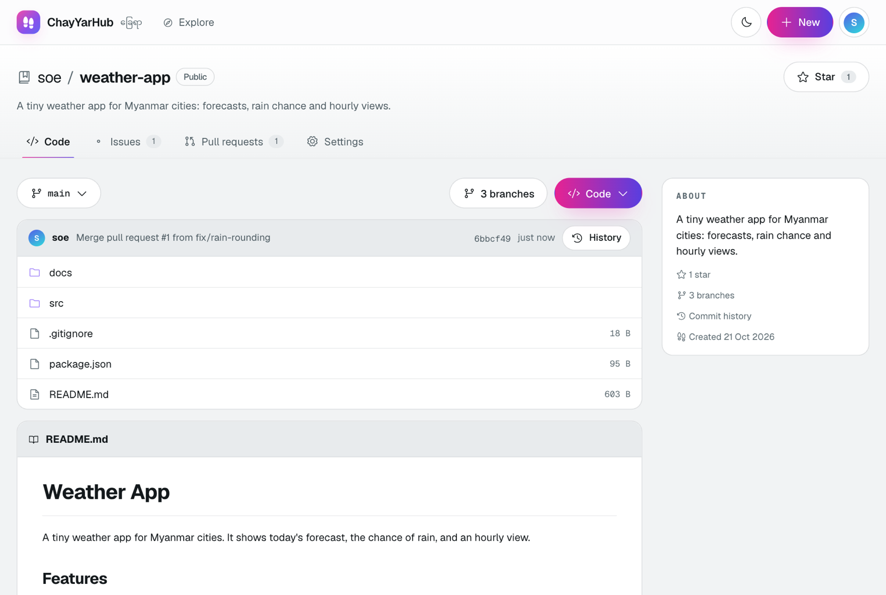
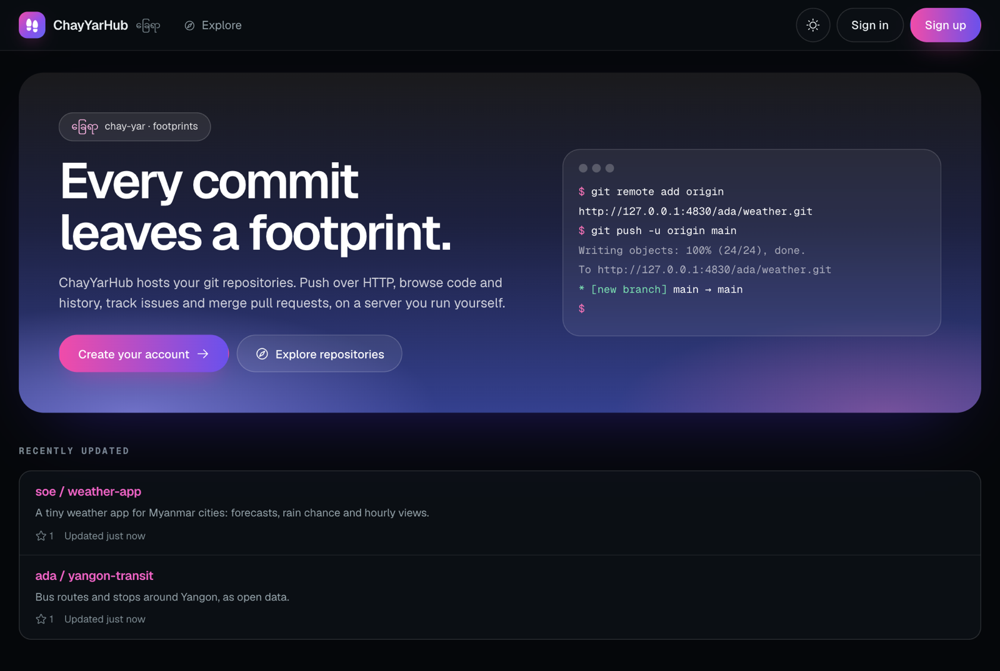
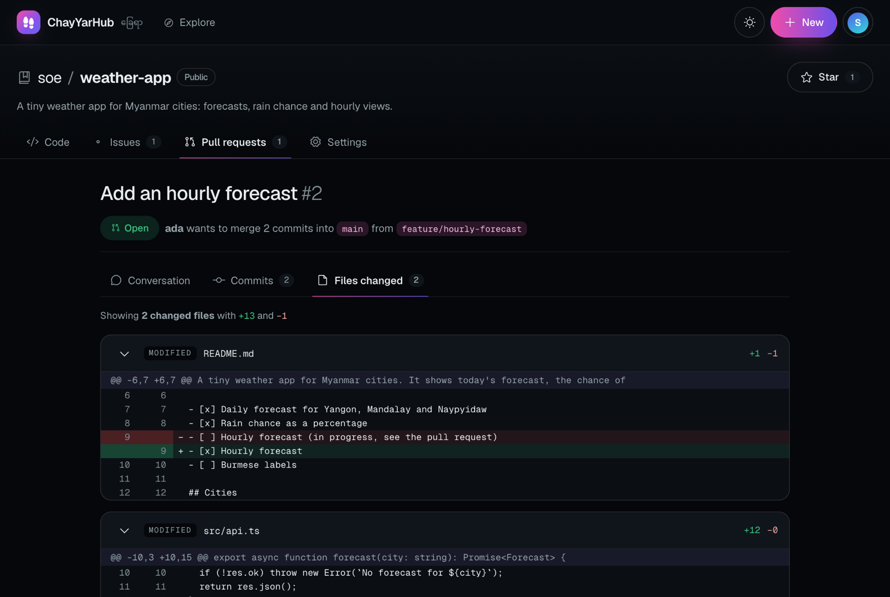
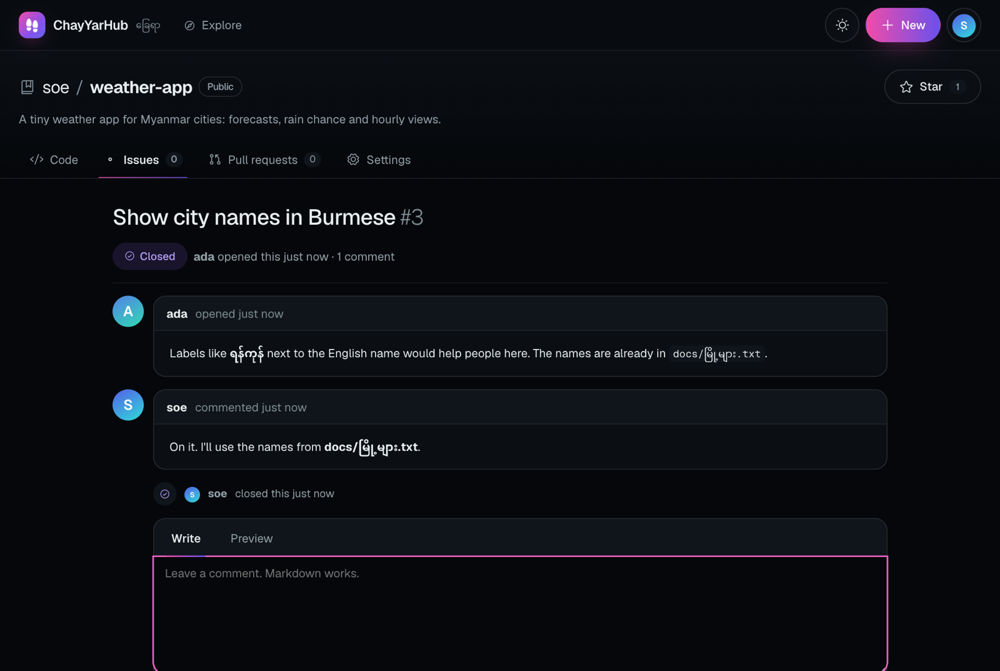
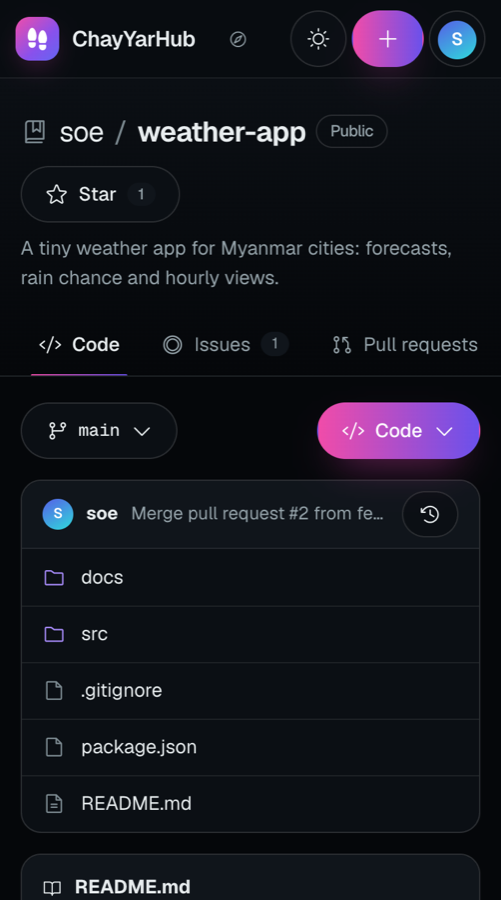

# ChayYarHub

**ChayYarHub** (ခြေရာ, *chay-yar*, "footprints") is a self-hosted git hub in the spirit of GitHub. Every commit leaves a footprint. Push your repositories to a server you run, then browse code and history, track issues, and review and merge pull requests in the browser.

It is built with **Angular 22** and **NestJS 12**, and stores its data in SQLite and your system's `git`.



## The ChayYar family

ChayYarHub is the centre of a family of tools, the way GitHub.com sits at the centre of GitHub Desktop, Actions, Pages and the rest.

| Product | Like | What it does | Status |
| --- | --- | --- | --- |
| **ChayYarHub** (this repository) | GitHub | Hosts repositories: code, history, issues, pull requests, accounts | v0.1, in progress |
| [**GitDesk**](https://github.com/Stephen-SMH/gitdesk) | GitHub Desktop | Desktop and browser client: changes, commits, history, branches, sync | v0.1, desktop and web |
| **SitMal** (စစ်မယ်, "will check") | GitHub Actions | Runs a repository's tests on every push and marks commits ✓ or ✗ | Planned |
| **PyaMal** (ပြမယ်, "will show") | GitHub Pages | Publishes a repository's website at its own address | Planned |
| **KuMal** (ကူမယ်, "will help") | Copilot | Suggests commit messages and reviews pull requests, using Claude | Planned |
| **`chayyar` CLI** | GitHub CLI | Pull requests and issues from the terminal | Planned |
| **ChayYarHub Mobile** | GitHub Mobile | Notifications and pull request review on your phone | Planned |

The names of planned products are working names.

## What it does

- **Accounts.** Sign up and sign in. Your username is your address, for example `/soe`.
- **Repositories.** Create one, public or private, optionally starting with a README. You can also star repositories, change a repository's description or visibility, and delete it.
- **Git over HTTP.** `git clone`, `fetch` and `push` work with your username and password, including protocol v2 and pushes of any size. Anyone can clone a public repository; only its owner can push.
- **Code browser.** Folders and files with line numbers, rendered READMEs and Markdown, images and raw files. You can browse at any branch, tag or commit, including branch names with slashes (`feature/x`) and Burmese file names.
- **History.** Commits grouped by day, a page per commit with its diff, and a branch list showing how far each branch is ahead of or behind the default.
- **Issues.** Open issues and comment on them in Markdown, with a preview. Close and reopen them, with every step shown in a timeline.
- **Pull requests.** Compare two branches to see their commits and changed files, with conflict detection before you merge. Merging creates a merge commit, like GitHub's default.
- **Explore and profiles**, plus a light and a dark theme.

| Landing page | A pull request's changes |
| --- | --- |
|  |  |
| **An issue, with Burmese text** | **On a phone** |
|  |  |

## Accessibility

- **Keyboard:** a "Skip to content" link, a visible focus ring, focus moved to the new page's content after each navigation, Escape to close menus, and arrow keys in a pull request's tabs.
- **Screen readers:** every control has a name, and states shown by icons (open, closed or merged; folder or file) are also written in text. Actions such as copying, starring, commenting and merging are announced. Form errors sit under their field and are linked to it.
- **Checked** with axe-core on every page in light and dark mode (no violations), at 375 px wide (no sideways scrolling), and with reduced motion turned on.

## Run it

You need Node 22.22.3 or newer and git 2.38 or newer.

```sh
npm run setup    # install the server's and the web app's dependencies
npm run build    # build the Angular app and the NestJS server
npm start        # http://127.0.0.1:4830
```

Open http://127.0.0.1:4830, sign up and create a repository. Then push to it:

```sh
git remote add origin http://127.0.0.1:4830/<you>/<repo>.git
git push -u origin main     # git asks for your ChayYarHub username and password
```

Your credential helper (Keychain, Git Credential Manager) remembers the password after the first push.

### Settings

Set these as environment variables, for example `PORT=8080 npm start`.

| Variable | Default | What it does |
| --- | --- | --- |
| `PORT` | `4830` | Port to listen on |
| `HOST` | `127.0.0.1` | Address to listen on. Use `0.0.0.0` to let other machines on your network connect. |
| `CHAYYAR_DATA` | `chayyarhub-data/` in this folder | Where accounts (`chayyarhub.db`) and repositories (`repos/<id>.git`) are kept |
| `CHAYYAR_URL` | the address in the browser | The public address, used in clone URLs. An `https://` address also turns on secure cookies. |
| `CHAYYAR_WEB` | `web/dist` | The built web app |

To back up a hub, copy its data folder while the server is stopped.

## Security

- Passwords are hashed with scrypt. A session is a random 256-bit token, and only its SHA-256 hash is stored. Session cookies are `HttpOnly` and `SameSite=Lax`, and also `Secure` when `CHAYYAR_URL` is HTTPS.
- A change (a sign-in, a comment, a merge) must come from ChayYarHub's own pages: requests from other origins are refused.
- A private repository answers "not found" to everyone but its owner, on the web and over git.
- Markdown is sanitised on the server. Raw files are served with a sandbox Content Security Policy, so an HTML or SVG file in a repository can't run script as ChayYarHub.
- Anything taken from a URL (a branch name or a path) is checked, then resolved to a commit SHA before git sees it, so it can't be read as a git option.
- The server itself speaks plain HTTP. To use it beyond your own machine or network, put it behind HTTPS (for example with Caddy) and set `CHAYYAR_URL`. Sign-in has no rate limiting yet.

## How it works

```
browser ── Angular app (web/) ── /api ──▶ NestJS (server/) ──▶ SQLite: users, sessions, stars, issues, pull requests
                                                │
                                                └──▶ git: log, ls-tree, diff, merge-tree, for browsing and merging
git client ── clone / push over HTTP ─▶ NestJS ──▶ git http-backend ──▶ bare repositories (chayyarhub-data/repos/<id>.git)
```

The server checks who you are and what you may do, then hands clones and pushes to `git http-backend`, git's own HTTP server program. That way the protocol details (v2, gzip, chunked pushes) are git's, not ours. Pages are rendered by reading the bare repositories with ordinary git commands. Merges are done in memory with `git merge-tree --write-tree`, so no working copy is ever checked out on the server.

## Develop

```sh
npm run dev:server   # NestJS on :4830, rebuilt on every change
npm run dev:web      # Angular on http://localhost:4200, passing /api to the server
npm test             # server unit tests, end-to-end tests, web unit tests
```

The end-to-end tests start a real server on a random port and drive it with the real `git` client. They cover accounts, pushing and cloning (with a Burmese file name and a 3 MB file), private repositories, the whole pull request flow, and merge conflicts.

```
server/   NestJS: controllers, SQLite (db.service.ts), git (git.ts, git-http.controller.ts)
web/      Angular: pages/ for site pages, repo/ for repository pages, shared/ for diff, Markdown and avatars
```

The look follows Soe's design system: Geist type, a rose-to-ember accent with blue for merged work, glass panels on dark, and a real light mode.

## Roadmap

- Collaborators and organisations, and forks with pull requests between them
- Access tokens and SSH keys for git
- Code search and syntax highlighting
- Line comments and reviews on pull requests
- Webhooks, which SitMal (CI) will use
- Signing in to ChayYarHub from GitDesk

## License

MIT © Soe Moe Htet (Stephen)
